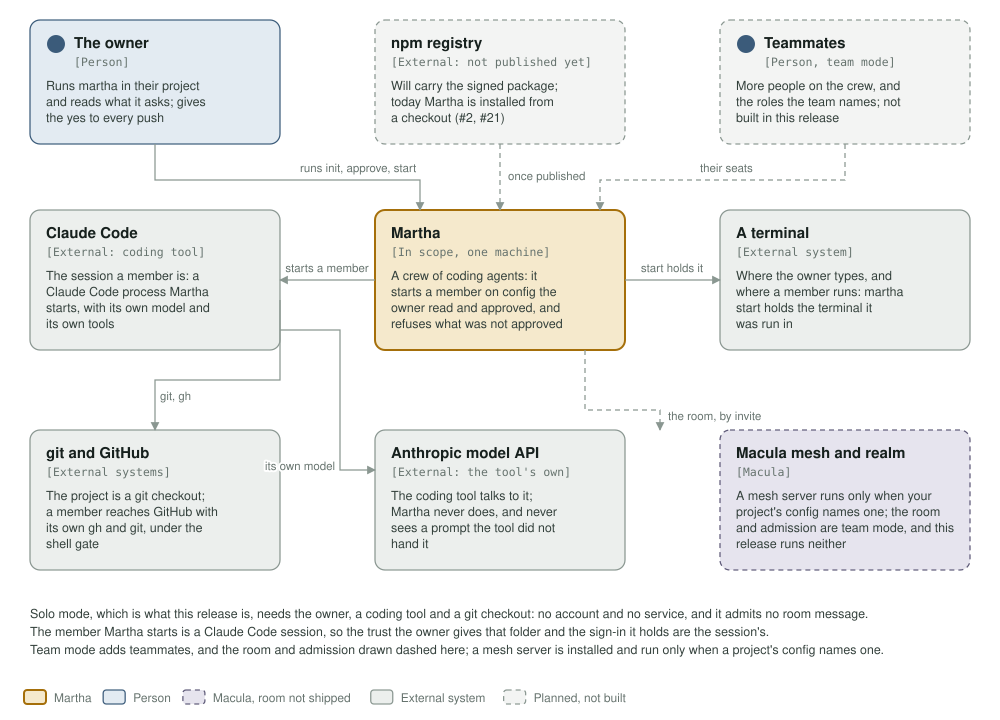
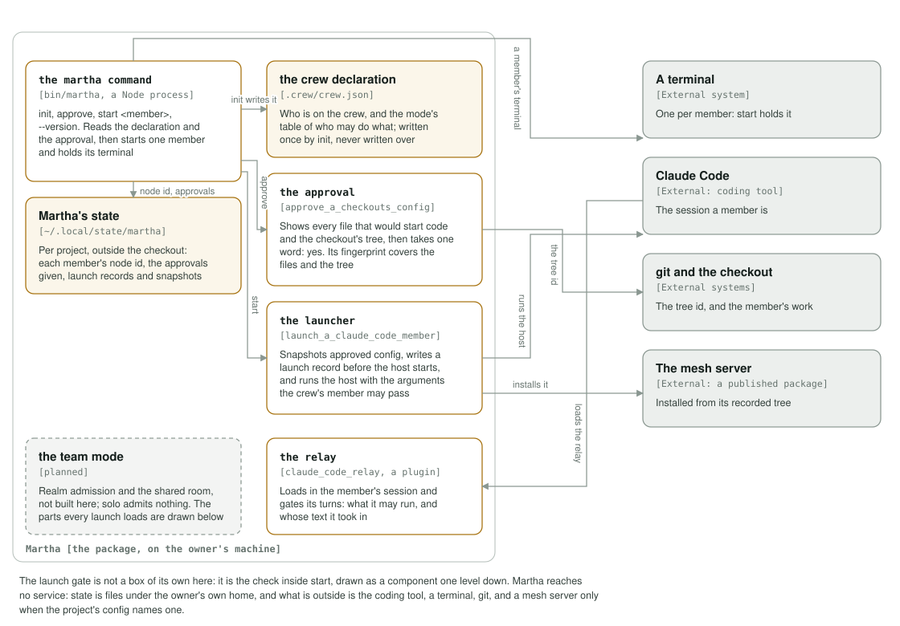
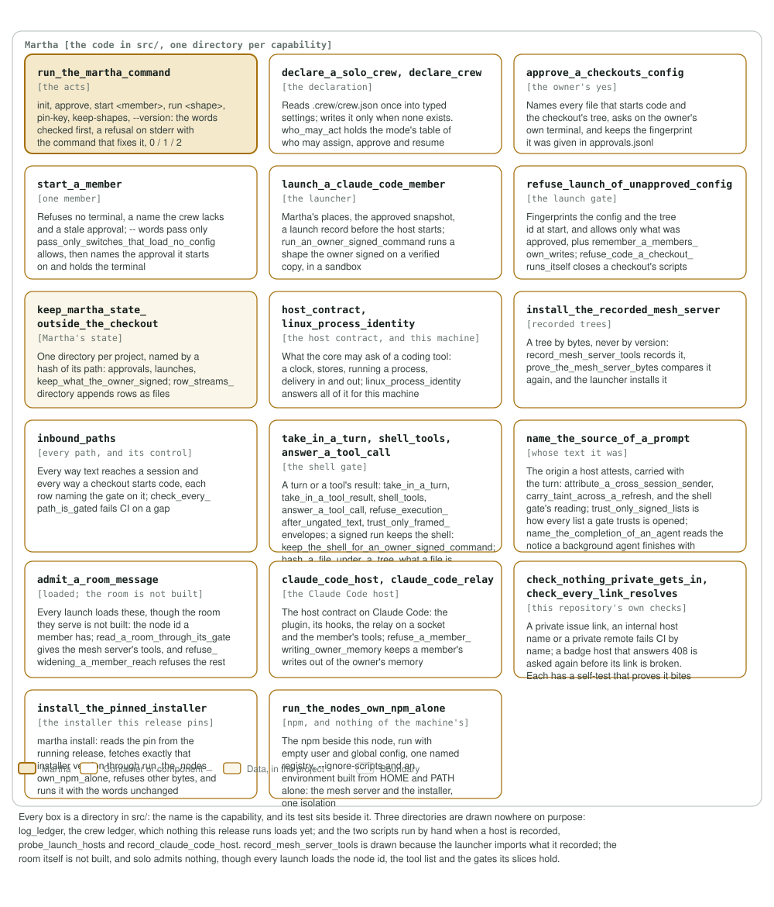

# Martha's architecture

This page shows, in three pictures, what Martha talks to, what it is made of, and
what its code is made of, drawn from the code that is here rather than from the
design it grew from.

> **Status: the launcher is built; the crew protocol is not.** The `martha`
> command (`init`, `approve`, `start`), the approval and launch gates and the
> relay are in `src/` and run. The crew's own protocol — the room, the ledger,
> parking and waking, the dashboard — is still to be ported; the order is in
> [the port map](../docs/port-map.md). A box drawn for something not built says
> so, and is dashed in the pictures.

## Context: who uses Martha, and what it reaches



| | Solo mode | Team mode |
|---|---|---|
| People | the owner | the owner and teammates, under the roles the team names |
| Coding tools | Claude Code, with Martha as a plugin | the same |
| Also needs | git, and a terminal | the same, plus the Macula mesh and realm |
| Who says yes to a push or a release | the owner | the people the team names |

Solo mode needs no account and no service, and admits no room message. The room
itself is not built, and every launch still loads pieces of its slices: the node
id a member has, the mesh server's tool list, the trust a turn is believed on, and
the refusal of reach-widening mesh tools. The Components table below names each of
them. A mesh server is installed and run only when the project's config names one,
in either mode. The npm registry is where the signed package will come from;
today it is installed from a checkout (#2, #21).

## Containers: what Martha is made of



| Container | What it does | Mode |
|---|---|---|
| **the `martha` command** | `init`, `approve`, `start <member>`, `--version`: reads the declaration and the approval, starts one member, and holds its terminal until the member ends. | both |
| **the crew declaration** | `.crew/crew.json` in the project: who is on the crew, and the mode's table of who may do what. Written once, never written over. | both |
| **the approval** | Shows every file that would start code and the checkout's tree, then takes one word: yes. Its fingerprint covers both. | both |
| **the launcher** | Snapshots approved config, writes a launch record before the host starts, and runs the host with the member's arguments. | both |
| **Martha's state** | `$XDG_STATE_HOME/martha`, or `~/.local/state/martha`: one directory per project, holding node ids, approvals, launch records and snapshots. Never in the checkout. | both |
| **the relay** | Loads inside the member's own session and gates its turns: what it may run, and whose text it took in. | both |
| **team mode** | Realm admission and the shared room. | team only, not built |

### The host contract

An adapter gives the core only what a coding tool physically has: a clock,
stores, running a process, delivery in and out (a turn handed to the model, and
where that turn came from as far as the tool itself can say), and registering a
tool. Nothing that decides anything lives in an adapter. A behaviour that one
host needs and another does not is a slice, never a branch in an adapter.
`src/claude_code_host` is the one adapter there is; an OpenCode adapter is
planned.

### One code path for two modes

The mode is data in the declaration: a table of who may assign work, approve a
push or a release, and resume parked work. Solo is a table with one person who
may do everything. Team is a table with roles. In solo mode no room is run, no
room message is admitted and no mesh call is made; what does load on every launch
is the node id, the mesh server's tool list, the envelope trust and the reach
refusal, and the Components table below names each of those slices.

## Components: what the code is made of



Every box is a directory in `src/`, and its test sits beside it. The names are
the capabilities, not the layers. A test fails when a directory in `src/` is in
none of the boxes and in none of the three left out below, so the picture cannot
fall behind the code.

| Component | What it does |
|---|---|
| `run_the_martha_command` | The acts (`init`, `approve`, `start`, `run`, `install`, `pin-key`, `keep-shapes`, `--version`), and the words they are used with: a refusal on stderr names the command that fixes it, and the exit status says which kind it was. |
| `declare_a_solo_crew`, `declare_crew` | Reads `.crew/crew.json` once into typed settings, and writes it only where there is none. `who_may_act` holds the mode's table. |
| `approve_a_checkouts_config` | Names what would start code, asks on the owner's own terminal, and keeps the fingerprint it was given. |
| `start_a_member`, `pass_only_switches_that_load_no_config` | Refuses no terminal, an unknown name and a stale approval; then names the approval it starts on. `pass_only_switches_that_load_no_config` is what the owner's `--` words pass: an allow-list of the switches that load no config, code or permission, and any other word is refused by name. |
| `launch_a_claude_code_member` | The places in Martha's state, the approved snapshot, the launch record, and the host's command and arguments. `run_an_owner_signed_command` runs a shape the owner signed for a member's `martha run`: on a copy of the bytes it verified against the signed base, the member's own writes and the base lock, in a sandbox with nothing else. |
| `refuse_launch_of_unapproved_config` | Fingerprints the config and the tree at start, and allows only what was approved; `refuse_code_a_checkout_runs_itself` closes a checkout's own scripts. |
| `keep_martha_state_outside_the_checkout` | One directory per project, named by a hash of its path; `row_streams_directory` appends rows as files; `keep_what_the_owner_signed` keeps the owner's pinned hardware key, the newest epoch of each signed list, and the signed command shapes. |
| `host_contract`, `linux_process_identity` | What the crew core may ask of a coding tool — a clock, stores, running a process, delivery in and out — and this machine's answers to it, without a host. |
| `install_the_recorded_mesh_server` | A tree by bytes, never by version: recorded by `record_mesh_server_tools` (itself a by-hand script, drawn here because the launcher imports what it recorded), proved by `prove_the_mesh_server_bytes`, installed by the launcher. |
| `inbound_paths` | Every way text reaches a session and every way a checkout starts code, each row naming the gate on it; `check_every_path_is_gated` fails CI on a gap. |
| `take_in_a_turn`, `shell_tools`, `answer_a_tool_call` | What a host calls when a session took something in, and what may run after: the gate on every tool call, `take_in_a_tool_result`, which records what a built-in tool's result handed the model, `refuse_execution_after_ungated_text`, which stops everything after unvetted text, and `trust_only_framed_envelopes`, what a turn may be believed on. `keep_the_shell_for_an_owner_signed_command` reads the owner's signed list of command shapes and decides when a run's result keeps the shell. |
| `name_the_source_of_a_prompt` | The origin a host attests, carried with the turn: with `attribute_a_cross_session_sender` and `carry_taint_across_a_refresh`; `trust_only_signed_lists` opens every list a gate trusts, from the owner's signed bytes. |
| `admit_a_room_message`, `read_a_room_through_its_gate` | The node id every member has, and the mesh server's tool list; `refuse_widening_a_member_reach` refuses the mesh tools that widen a member's reach. The room itself, which would admit a crew or shared message, is not built — yet every launch loads these parts of its slices, so the box is not dashed. |
| `claude_code_host`, `claude_code_relay` | The host contract on Claude Code: the plugin and its hooks, and the relay that answers over a socket. |
| `check_nothing_private_gets_in`, `check_every_link_resolves` | This repository's own checks. A private issue link, an internal host name or a private remote fails CI by name. A link is called broken only when it really is: a host that answers 408, 429 or a 5xx, or times out, is asked again before its link fails, while a 404 or a missing file fails at once, by name. `check_posted_text_carries_nothing_private` reads the text members post on GitHub — issue titles and bodies, issue comments, pull-request titles and bodies, review bodies, inline review comments and commit comments — and refuses the same classes there, by name; it writes nothing, and a red run is the signal. `check_the_logos_are_valid_svg` holds every logo to well-formed XML, on this repository's own Node rather than through `xmllint` from the Ubuntu archive. `check_no_test_the_base_passed_goes_missing` names every test title the merge base holds that the branch's tip no longer does, by file and title; a deliberate removal passes only when a commit in the range says which title (or file) it drops, and a claim that excuses nothing fails too. |
| `install_the_pinned_installer` | `martha install`: the installer the running release pins, and no other — the pin read from the release's own tree, the exact version fetched, other bytes refused by name, and the installer run with the words unchanged. |
| `run_the_nodes_own_npm_alone` | npm, and nothing of the machine's: the npm beside this node, empty user and global config, one named registry, `--ignore-scripts`, and an environment built from `HOME` and `PATH` alone. The mesh server's install and the pin's install share it, so they cannot drift apart. |
| `write_my_handover`, `park_and_wake_a_member` | A member outliving its context: the host writes the one handover file a member has and stamps it, and a park is a marker in the crew's store that a clear, a restart or a refresh cannot lose. `crew_files_directory` is the host glue that keeps both whole there, so no slice touches a disk. Part 1 of the package: the refresh flow, the tool and the wake verb come with part 2, so no launch loads them yet. |

### Left out of the Component diagram on purpose

Four directories in `src/` are drawn in no box, because nothing that runs loads
them. The same test above fails if any other directory joins them without a box:

| Left out | Why |
|---|---|
| `log_ledger` | The crew ledger — a row per milestone and per outward act. Nothing this release runs loads it yet: the crew protocol it belongs to is still to be ported. |
| `open_and_finish_a_worktree` | The two worktree tools, `worktree_open` and `worktree_finish`. A member's session cannot call them yet, because the launcher registers no tool. |
| `probe_launch_hosts` | A script run by hand, `npm run probe:launch`, to probe a coding tool's launch. The `martha` command never loads it. |
| `record_claude_code_host` | A script run by hand, `npm run record:claude-code-host`, when the coding tool is upgraded. The adapter reads the recording it writes; the script itself never runs. |

## Keeping the pictures true

The three SVGs are drawn by [`c4_diagrams.ts`](c4_diagrams.ts), and a test fails
when an SVG in `assets/` is not what that file draws. After changing a box:

```sh
node architecture/c4_diagrams.ts
npm test
```

Then render each one and look at it, and keep the tables on this page in step:

```sh
rsvg-convert -w 1400 assets/c4-components.svg -o /tmp/c4.png
```
