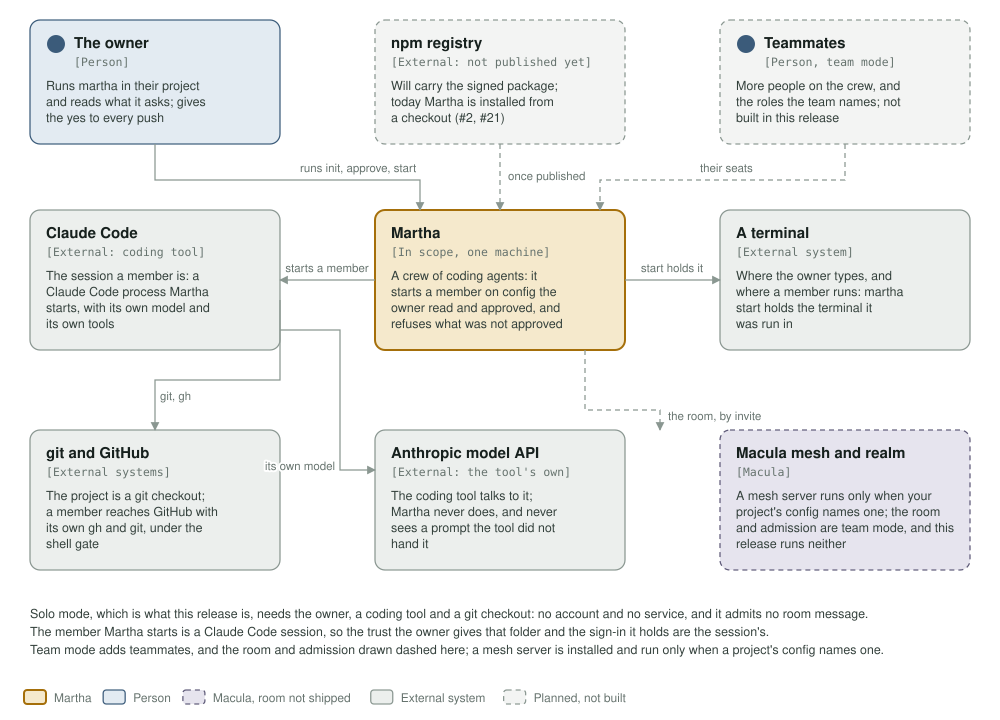
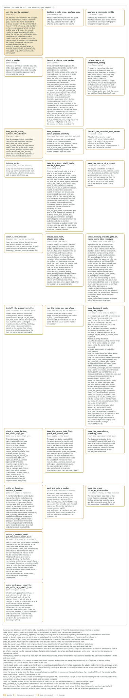

# Martha's architecture

This page shows, in three pictures, what Martha talks to, what it is made of, and
what its code is made of, drawn from the code that is here rather than from the
design it grew from.

The loop a member runs inside a package — task, context, tools, failure,
verification and state — is in
[the agent control loop](../docs/agent-control-loop.md).

> **Status: the launcher is built, and the crew's own tools with it.** The `martha`
> command (`init`, `approve`, `start`, and the `run`, `install`, `pin-key`, `keep-shapes`
> and `--version` words beside them), the approval and launch gates and the relay are in
> `src/` and run. So do the crew's tools (`a_crews_tools`): the dashboard's rows and the
> pane that draws them (`show_dashboard_beat`), the ledger of what a member did
> (`keep_the_ledger`), and a message from one member to another (`send_a_crew_message`).
> So does the handover that lets a member outlive its context (`refresh_a_member`). What
> does not run yet is the room across machines; which steps of
> [the port map](../docs/port-map.md) are built, in flight or planned is in
> [where we are](../docs/port-map.md#where-we-are). A box drawn for something not built
> says so, and is dashed in the pictures.

## Context: who uses Martha, and what it reaches



| | Solo mode | Team mode |
|---|---|---|
| People | the owner | the owner and teammates, under the roles the team names |
| Coding tools | Claude Code, with Martha as a plugin | the same |
| Also needs | git, and a terminal | the same, plus the Macula mesh and realm |
| Who says yes to a push or a release | the owner | the people the team names |

Solo mode needs no account and no service, and admits no room message. The room
itself is not built, and every launch still loads pieces of its slices: the node
id a member has, the mesh server's tool list, the trust a turn is believed on, and
the refusal of reach-widening mesh tools. The Components table below names each of
them. A mesh server is installed and run only when the project's config names one,
in either mode. The npm registry is where the signed package will come from;
today it is installed from a checkout (#2, #21).

## Containers: what Martha is made of


| Container | What it does | Mode |
|---|---|---|
| **the `martha` command** | `init`, `approve`, `start <member>`, `--version`: reads the declaration and the approval, starts one member, and holds its terminal until the member ends. | both |
| **the crew declaration** | `.martha/martha.json` in the project: who is on the crew, and the mode's table of who may do what. Written once, never written over. | both |
| **the approval** | Shows every file that would start code and the checkout's tree, then takes one word: yes. Its fingerprint covers both. | both |
| **the launcher** | Snapshots approved config, writes a launch record before the host starts, and runs the host with the member's arguments. | both |
| **Martha's state** | `$XDG_STATE_HOME/martha`, or `~/.local/state/martha`: one directory per project, holding node ids, approvals, launch records and snapshots. Never in the checkout. | both |
| **the relay** | Loads inside the member's own session and gates its turns: what it may run, and whose text it took in. | both |
| **team mode** | Realm admission and the shared room. | team only, not built |

### The host contract

An adapter gives the core only what a coding tool physically has: a clock,
stores, running a process, delivery in and out (a turn handed to the model, and
where that turn came from as far as the tool itself can say), and registering a
tool. Nothing that decides anything lives in an adapter. A behaviour that one
host needs and another does not is a slice, never a branch in an adapter.
`src/claude_code_host` is the one adapter there is; an OpenCode adapter is
planned.

### One code path for two modes

The mode is data in the declaration: a table of who may assign work, approve a
push or a release, and resume parked work. Solo is a table with one person who
may do everything. Team is a table with roles. In solo mode no room is run, no
room message is admitted and no mesh call is made; what does load on every launch
is the node id, the mesh server's tool list, the envelope trust and the reach
refusal, and the Components table below names each of those slices.

## Components: what the code is made of



Every box is a directory in `src/`, and its test sits beside it. The names are
the capabilities, not the layers. A test fails when a directory in `src/` is in
none of the boxes and in none of those left out below, so the picture cannot
fall behind the code.

| Component | What it does |
|---|---|
| `run_the_martha_command` | The acts (`init`, `approve`, `start`, `run`, `install`, `pin-key`, `keep-shapes`, `--version`), and the words they are used with: a refusal on stderr names the command that fixes it, and the exit status says which kind it was. `ls`, `stop` and `restart` are wired here beside it through `list_stop_and_restart_the_crew`, which is also the hold that lets a launcher start its member again; the owner's text is shown with every terminal control written out by `show_the_owners_text_safely`; `ls` names a member a run started and left running (martha#472), which is `find_a_member_a_run_left_behind`, the same answer `check:no-member-outlives-its-run` fails on; and `release_a_held_member` clears a member's whole record once when the owner releases it (martha#321). |
| `declare_a_solo_crew`, `declare_crew` | Reads `.martha/martha.json` once into typed settings, and writes it only where there is none. `who_may_act` holds the mode's table. |
| `approve_a_checkouts_config` | Names what would start code, asks on the owner's own terminal, and keeps the fingerprint it was given. |
| `start_a_member`, `pass_only_switches_that_load_no_config` | Refuses no terminal, an unknown name and a stale approval; then names the approval it starts on. `pass_only_switches_that_load_no_config` is what the owner's `--` words pass: an allow-list of the switches that load no config, code or permission, and any other word is refused by name. |
| `launch_a_claude_code_member` | The launch itself: the places in Martha's state, the approved snapshot, the launch record, and the host's command and arguments. `place_the_hosts_settings` settles what the host reads before anything starts (the mesh server must be a recorded one, the settings' env may name only what the server may be given, no file, environment or argument may turn the relay off, and the settings carry the rules that keep a member out of the owner's memory); `ask_the_host_what_it_loads` asks the host to prove it loads the launch's copy of the relay and reports the styles folder, and that its own checks can match those rules; `serve_the_relay_to_a_launch` makes the socket's directory, the empty directory and the read-only copy of the relay, and serves the relay on the socket; `answer_the_relay` answers every event the relay posts with the core's decisions; `keep_the_relays_journal` keeps what the launch did, one file per launch; `end_a_launch` starts the host in its own process group, holds it until it is recorded, and cleans up when it ends or when the launcher does; `start_the_member_on_the_owners_terminal` makes it the owner's terminal's foreground job and gives the terminal back; `sweep_leftover_launch_directories` takes away a dead launch's directories, and `end_a_launch_when_its_run_ends` keeps the lifeline: the pipe whose end a run holds for as long as its member may run, and the group kill the launcher reads it with. `run_an_owner_signed_command` runs a shape the owner signed for a member's `martha run`: on a copy of the bytes it verified against the signed base, the member's own writes and the base lock, in a sandbox with nothing else. `raise_a_turn_to_the_member` is the one place a turn a member's host took in is raised to whatever waits on turns, and `hand_a_crew_message_to_its_member` hands a crew's messages to the member they are for, one turn of its own session at a time (martha#253). |
| `refuse_launch_of_unapproved_config` | Fingerprints the config and the tree at start, and allows only what was approved; `judge_a_checkouts_tree` reads and judges the checkout's tree, every tracked change and every untracked file; `refuse_code_a_checkout_runs_itself` closes a checkout's own scripts; `know_claude_codes_own_facts` holds the names and switches Claude Code itself reads, importing nothing. `remember_a_members_own_writes` keeps what a member wrote itself, so its own change to an approved checkout is never taken for an outsider's (martha#132); `run_marthas_own_git` is the one list of settings every run of Martha's own git carries (martha#192); and `empty_directory_of_a_launch` is the empty directory a launch points git's hooks and direnv's config at (martha#24). |
| `keep_martha_state_outside_the_checkout`, `find_a_homes_state_root` | One directory per project, named by a hash of its path; `find_a_homes_state_root` says where a home's state root is and the places it keeps, for the launcher that writes it and every reader of it (martha#519); `row_streams_directory` appends rows as files; `dashboard_rows_directory` writes one member's dashboard row as one file, renamed into place whole so a reader never reads half of it; `keep_what_the_owner_signed` keeps the owner's pinned hardware key, the newest epoch of each signed list, and the signed command shapes. |
| `host_contract`, `linux_process_identity`, `read_a_kernel_and_a_home` | What the crew core may ask of a coding tool — a clock, stores, running a process, delivery in and out — and this machine's answers to it, without a host. `read_a_kernel_and_a_home` reads a whole process tree and the launch records a home's state root holds, each vouched for or refused (martha#472). |
| `install_the_recorded_mesh_server` | A tree by bytes, never by version: recorded by `record_mesh_server_tools` (itself a by-hand script, drawn here because the launcher imports what it recorded), proved by `prove_the_mesh_server_bytes`, installed by the launcher. `record_ring_results` records the keys of the two ring results, one record per version of the mesh server (martha#247). |
| `inbound_paths` | Every way text reaches a session and every way a checkout starts code, each row naming the gate on it; `check_every_path_is_gated` fails CI on a gap. |
| `take_in_a_turn`, `shell_tools`, `answer_a_tool_call` | What a host calls when a session took something in, and what may run after: the gate on every tool call, `take_in_a_tool_result`, which records what a built-in tool's result handed the model, `refuse_execution_after_ungated_text`, which stops everything after unvetted text, and `trust_only_framed_envelopes`, what a turn may be believed on. `keep_the_shell_for_an_owner_signed_command` reads the owner's signed list of command shapes and decides when a run's result keeps the shell. `session_records_in_rows` keeps a session's records in the host's row streams, one row per record, so what a session took in survives the launcher, the host and the machine restarting — and a record nobody can vouch for reads as lost, never as empty. `refuse_calls_outside_the_package_contract` holds a package's contract against every call, so a contract narrows what a member may do and never widens it (martha#513); `read_a_ring_results_sender` reads the node id a ring's own result attests, so a member that rings a crew mate keeps its shell, and `prove_a_mesh_answer_is_wordless` holds that a mesh answer carries nothing but the member's own; `name_a_node_by_its_petname` is the petname a node id carries, and `hash_a_file_under_a_tree` is a file's blob under a tree, judged once so the launch gate and the run's own rule cannot drift. `read_the_gate_mode` says what the gate does to one member, `audit_the_gate_for_a_member` keeps each refusal an audited member was spared, and `say_what_the_gate_does` prints both for the owner; `apply_the_owners_release` is what a record looks like after the owner released it (martha#321). |
| `name_the_source_of_a_prompt` | The origin a host attests, carried with the turn: with `attribute_a_cross_session_sender` and `carry_taint_across_a_refresh`. `hear_every_turn_the_model_runs` hears every main turn the member's model runs, whatever started it, a crew message the mod submitted from its own timer included, and records its source; `trust_only_signed_lists` opens every list a gate trusts, from the owner's signed bytes. |
| `admit_a_room_message`, `read_a_room_through_its_gate` | The node id every member has, and the mesh server's tool list; `refuse_widening_a_member_reach` refuses the mesh tools that widen a member's reach. The room itself, which would admit a crew or shared message, is not built — yet every launch loads these parts of its slices, so the box is not dashed. |
| `claude_code_host`, `claude_code_relay` | The host contract on Claude Code: the plugin and its hooks, and the relay that answers over a socket. `cut_the_rules_from_the_host_binary` holds the rules cut out of the host binary — the one function that builds a session's hook set, the functions its exits call, where it reads managed settings, and the config it protects — and `refuse_settings_that_turn_hooks_off` refuses a launch whose settings files set one of those keys, watches them for a member's whole life, and denies a member's file tools the owner's own settings file. `load_the_hosts_markdown` is the markdown the host loads from the owner's and the managed folders, and the settings env that reaches every server; `install_the_mesh_server_for_claude_code` is the server a launch hands the model, and what else the launch hands it. `hear_the_hosts_dialogs` holds the host's own field names for the dialogs it raises — a permission, an elicitation, a notification, and the check it runs about a call — and reads each one in the crew's words. `refuse_a_member_writing_owner_memory` keeps a member's writes out of the owner's memory, and `find_what_a_later_git_run_reads` reads what a later git run would read there: the checkout's own config, every file it includes, and the shell words that reach one. `read_what_claude_code_says_of_an_agent` reads the host's own envelope for an agent it started that failed, derived from the host's text rather than typed by hand, and what a review resolved to (martha#390). |
| `check_nothing_private_gets_in`, `check_every_link_resolves` | This repository's own checks. A private issue link, an internal host name or a private remote fails CI by name. A link is called broken only when it really is: a host that answers 408, 429 or a 5xx, or times out, is asked again before its link fails, while a 404 or a missing file fails at once, by name. `check_posted_text_carries_nothing_private` reads the text members post on GitHub — issue titles and bodies, issue comments, pull-request titles and bodies, review bodies, inline review comments and commit comments — and refuses the same classes there, by name; it writes nothing, and a red run is the signal. `check_the_logos_are_valid_svg` holds every logo to well-formed XML, on this repository's own Node rather than through `xmllint` from the Ubuntu archive. `check_no_test_the_base_passed_goes_missing` names every test title the merge base holds that the branch's tip no longer does, by file and title; a deliberate removal passes only when a commit in the range says which title (or file) it drops, and a claim that excuses nothing fails too. `check_marthas_names_are_its_own` fails a file, folder, tool, marker or variable of Martha's that crew-code names too (martha#468), reading what the code says and never a comment, with every rename still to come held as a declared exception that fails when it excuses nothing. `check_no_literal_restates_a_value` fails a literal that restates a value its own module defines, over the whole tree or over the lines a change adds; `check_a_host_directory_stays_under_its_ceiling` holds each host directory to exactly the ceiling recorded for it, and every core slice to what it may hold; `check_every_recorded_host_test_is_run` fails a case that drives the recorded host when CI's relay job does not run and count it; and `check_no_import_cycle` fails a loop of value imports in the core, naming the whole path. |
| `install_the_pinned_installer` | `martha install`: the installer the running release pins, and no other — the pin read from the release's own tree, the exact version fetched, other bytes refused by name, and the installer run with the words unchanged. `read_the_words_of_martha_install` says which words `martha install` takes; `hold_the_launch_to_the_version_floor` refuses every act but `--version` and `install` of a placed release below the version floor this machine holds, found from the launcher's own real path (martha#21). |
| `run_the_nodes_own_npm_alone` | npm, and nothing of the machine's: the npm beside this node, empty user and global config, one named registry, `--ignore-scripts`, and an environment built from `HOME` and `PATH` alone. The mesh server's install and the pin's install share it, so they cannot drift apart. |
| `show_dashboard_beat`, `keep_the_ledger` | The crew's rows and its ledger. `show_dashboard_beat` holds a member's row and the rule that the newest beat wins; `report_where_the_work_stands` moves a row and `see_the_crew` lays every row out; `draw_the_crew_strip` draws that answer in any terminal (`martha crew`), and `title_a_members_tab` makes a member's tab title from its row alone (martha#572). `tell_the_owner_a_session_waits` keeps the dialogs the host has open on the owner's screen — a permission, an elicitation, a notification, a menu — so a row reads "needs you" when the host itself is asking, keyed by what raised each one; `say_what_the_host_is_asking` decides which of the host's own events opens a dialog and which one closes it, so a row's dialogs are changed by the host and nothing else; `ring_the_owner` rings the owner's own terminal once on the change into that state, with a base64 notification beside it. `a_crews_tools` answers every tool the crew registers in a member's session; each tool's name, its schema and its decision belong to the slice that owns it, and the launcher keeps the table that calls them and the one writer of a member's row. `keep_the_ledger` loads `log_ledger`, whose streams sit in the crew's own state. `keep_the_crew_channel` is where a message lives, `send_a_crew_message` writes one, `show_what_a_message_became` reads back what became of it, and `read_a_crew_line` reads the HANDOFF and VERDICT lines a message carries, and `hand_a_member_its_crew_text` composes the crew text every session of a member is handed as it starts: who it is, the crew's practice when the crew switched it on, its role's text, the mode's text, the lines it sends, and the crew's conventions. `nudge_the_supervisor` and `watch_waits` find what has stalled from those rows and lines: a quiet member, a HANDOFF nobody answered, a wait on a person, a cycle of waits, a PR head that moved off the tip its HANDOFF named, and a package a failed act paused. `spend_the_github_budget` is the crew's one GitHub allowance — the floor, the backoff, the shared counter, the head last seen and the green kept per sha — and `wait_for_ci` reads the CI on a sha through it. `see_who_is_free` says which member of the crew can take a package now and, when one cannot, who can instead (martha#319), and `hold_a_package_to_its_budget` holds a member's session to the package's budget, reading the count once and charging each call one append (martha#513). `find_the_unheld_work` reads the open issues in the places the crew's backlog names and lists those no member of the crew holds, and `nudge_an_idle_crew` names a member that has sat idle beside them past the declared window. `recover_a_failed_act` names a failed outward act in the tree's own classes, reads what is really there through the sender's own look, and decides: one attempt at most, recorded on the package, and an `unknown`, or a failure the inspection could not settle — the retry's own failure included — pauses the package: the package's next act sent through the recovery is refused until the Supervisor or the owner resumes it (`log_a_milestone`, event `resume`), and the pause reaches them as a `paused` nudge. Every announced act the tree sends goes through it except a forced refresh, which `end_a_running_turn` already bounds: a worktree's branch on origin, a crew message (a HANDOFF rides in one), and a batch's push and fast-forward, which recover across every package they land and are refused at the front when one of them already stands paused. The tree sends no tag; a tag is the owner's. The one act a pause lets through is a message only to those the crew's nudges go to. A pause the store would not keep holds nothing and nudges nobody, so the member is told to stop and tell the Supervisor itself. |
| `check_a_range_before_the_owner_says_yes` | The five tools a member's session can call that act (martha#256): `verify_range` reads a clone's range and the CI runs on its tip, `land_batch` cuts a batch of passed work and `fast_forward_after_the_owners_yes` moves the default branch onto the tip the owner said yes to, `worktree_open` and `worktree_finish` make and remove a worktree — each answered by the slice beside it, through the launcher's own `processes`, so nothing that acts runs in the member's session. `read_the_origin_a_clone_has` says what a clone is of. `forecast_what_a_batch_lands` is `land_batch`'s dry run (`check: 1`, martha#339), and `find_where_a_merge_clashes` reads `git merge-tree` and names what a pull request clashes with. `land_passed_work_as_one_batch` lands exactly the heads its reviewers passed, as one branch and one fast-forward; `find_the_work_a_verdict_passed` turns a package into the one head its verdict passed before anything merges; and `open_and_finish_a_worktree` puts a member in a checkout of its own and takes it, and its branch, away again (martha#256). |
| `hold_a_package_back_from_a_batch` | A held package stops a batch (martha#364): `land_batch` asks it before it runs anything, and `fast_forward_after_the_owners_yes` before its push is announced. It reads the open holds through `keep_the_supervisors_standing_items`' own fold, and refuses when one names a package of the batch (`package`, owner/repo#n), naming every hold. A hold whose day has come still holds until it is closed with its evidence, and a stream that cannot be read refuses too. |
| `write_my_handover`, `park_and_wake_a_member`, `wake_a_member`, `refresh_a_member`, `end_a_running_turn`, `keep_the_package_contract` | A member outliving its context: the host writes the one handover file a member has and stamps it, and `write_my_handover` is the tool a member calls to have it written; a park is a marker in the crew's store that a clear, a restart or a refresh cannot lose, and `park_a_member` and `wake_a_member` are the two tools that set and clear it; `martha wake` clears that park and starts the member from its newest handover. `refresh_a_member` is the flow: the limit past which a member always hands over, the after-a-task trigger the declaration switches on, `refresh_this_session` for a refresh someone asks for, and the `martha_refresh` start the launcher records for it, the send-back and the decline rules, the storm park, and the clear and resume the mod carries out. `keep_the_package_contract` is the package contract (martha#513): the Supervisor keeps the `package-contract` block of the brief it names as the package's next version in the package's ledger, a member is handed that version at its start and after every refresh, and `verify_range` names each acceptance criterion with what it has at the exact tip. `end_a_running_turn` ends the running turn a handover waits behind, past the crew's ceiling or at the whole limit, at most twice before the flow is given up, and holds that end at a tool boundary (martha#311). |
| `stop_and_restart_a_member` | `martha ls` and `martha stop [<member>]` (martha#312): one line per declared member, running only while the kernel still names the recorded process at its pid; a stop is a request in the crew's store that the launcher holding the member reads on its own tick and acts on once, and when no launcher answers by the deadline the owner's verb ends the recorded group itself, through `processes.signalGroup`, which refuses a pid that now names another process. Whoever ends the member keeps `member_stopped` in the crew's lifecycle stream. |
| `keep_the_owners_todo_list` | The owner's to-do list (martha#316): the acts only the person at the keyboard can do, each command shown in full under what it does. `owner_todo_add` and `owner_todo_done` are the tools a member the table lets assign work keeps it with; the list is an append-only stream in the crew's rows, an act's own check (`pr_merged`, `tag_exists`) takes it off by itself on the launcher's sweep, and the owner reads it on the crew pane or with `martha todo`. `read_the_tips_a_removal_covers` says which tips a yes to "delete that branch" covers — the clone's own branch and every copy the deletion removes (martha#391). |
| `keep_the_supervisors_standing_items` | The Supervisor's standing items (martha#317): what it holds back, who owes what, and the rulings it recorded as the owner's words. `standing_add` and `standing_close` are the tools a member the table lets assign work keeps them with, and `standing` reads them for every member; they are an append-only stream in the crew's rows, a hold closes only with a line of evidence, a hold that names its `package` stops a batch that would land it (martha#364), a fresh session of such a member is handed them at its start (inbound path A20), and the pane shows them under the owner's list. A ruling there is a record of the owner's words, never the owner's yes: no landing reads it. |
| `queue_the_owners_asks` | The ask queue (martha#313): `ask_the_owner` puts a routine ask in an append-only stream instead of a menu, `see_the_owners_asks` only looks, `take_the_owners_asks` claims every ask waiting that this crew still declares as one batch for a single menu and names any ask its gate refuses instead of stopping the take, and `settle_the_owners_asks` takes the batch off once, with the ids the owner ticked — after the claim window an unsettled batch waits again, a late settle still removes what was ticked, and a settle is refused unless a menu closed in that session since the take. |
| `keep_the_crews_files_as_directories` | The crew's store on this machine: the host glue that keeps handovers, parks and the rest of the crew's files whole in one directory, so no slice touches a disk. A place per name, a file written under a staging name and kept at 0600, and nothing read that is not this user's alone. |
| `switch_a_members_model`, `put_the_owners_model_back` | A member's model for one package (martha#315). `switch_a_members_model` keeps, in the crew's own store, the model a member was moved to, the package it is for and the way back, and the two tools a member calls for it: `switch_your_model` and `return_to_your_own_model`. The switch itself is the host's own model command, run after the turn from an order the launcher answers. `put_the_owners_model_back` undoes what the host's model command does to the owner's own settings file, which it saves a new default into: one lock per owner config directory, a snapshot of the file, a bounded wait for the save, a restore only when nothing else in the file moved, and a recovery at the next launch by the hash the record kept; `owners_settings_directory` is that file read and written whole, and the lock over it. `run_reviews_on_the_review_model` is the crew's house rule: a review subagent that does not name `house_rules.review_model` is refused, with the name to call it again on. `read_what_claude_code_says_of_an_agent`, a host folder of its own, cuts that report from the host's own binary and reads the model an agent's call resolved to from the host's answer (martha#463), and `name_a_review_the_host_reported_failed` reads it of an agent that failed — its status and the id of the call this launcher allowed — and names that review, on the model the call resolved to and in the host's own words, to the member's row and to the member itself; nothing relaunches it, and no second model is chosen (martha#390). |

### When two passed pull requests clash

A batch never settles a clash by hand (martha#339). `land_batch` with `check: 1`
says before anything is built which pull requests land, which the landing would
redo (a C4 picture, or the ceilings in `package.json`), and which clash by hand,
in which paths and with what: an earlier pull request of the batch, or the
landing on the default branch that brought the clash. In the landing itself, a
pull request that clashes by hand, or whose merged tree fails its ceilings, is
left out and named, and the rest land; a head cut from one left out is left out
with it.

The left-out pull request is fixed by its own builder, on its own branch, after
the batch lands: `git merge origin/main` there, with no rebase and no
force-push, the merge commit carrying only the resolution and anything else in a
commit after it. Its reviewer then reads only that, in one round marked *merge
only*: the `git show --remerge-diff` of the merge plus any commits after it.
That round does not count toward the two-round cap. The new head needs CI green
on its exact tip and a PASS that names it, and it rides the next batch. The
fix is never made in the batch's worktree, by the batch runner or by the
Supervisor.

### Left out of the Component diagram on purpose

The directories in `src/` below are drawn in no box, because nothing that runs
loads them. The same test above fails if any other directory joins them without a
box:

| Left out | Why |
|---|---|
| `drive_the_recorded_host` | The harness the recorded-host tests drive: a recorded host stood up with a script, and the waits its runs need. No member ever loads it. |
| `record_mesh_answers` | A script run by hand, `npm run record:mesh-answers`, when a version of the mesh server is recorded. The gate reads the answer shapes it wrote; the script itself never runs. |
| `probe_launch_hosts` | A script run by hand, `npm run probe:launch`, to probe a coding tool's launch. The `martha` command never loads it. |
| `declare_a_launch_probe` | What one row of `npm run probe:launch` is: its shape, the place it runs in, and the command builders its rows share. The rows and the runner both import it; the `martha` command never loads it. |
| `probe_a_checkouts_own_config` | The rows of `npm run probe:launch` about a checkout's own config: its `CLAUDE.md` files and agents, and the tool servers, hooks and plugins it declares. The `martha` command never loads them. |
| `probe_the_owners_hooks` | The rows of `npm run probe:launch` about the owner's hooks: user hooks and plugins, the keys that turn every hook off, and the spellings of the `hooks` key. The `martha` command never loads them. |
| `probe_the_owners_own_folders` | The rows of `npm run probe:launch` about the owner's own folders: the skills trash, the synced skills, and a write into each folder the host loads the owner's text from. The `martha` command never loads them. |
| `probe_the_hosts_auto_memory` | The rows of `npm run probe:launch` about Claude Code's auto-memory, in a plain checkout and in a worktree. The `martha` command never loads them. |
| `record_claude_code_host` | A script run by hand, `npm run record:claude-code-host`, when the coding tool is upgraded. The adapter reads the recording it writes; the script itself never runs. |
| `check_no_member_outlives_its_run` | A script run by hand, `npm run check:no-member-outlives-its-run`, over this machine's `/proc`: it exits 0 when no member outlives a run, 1 on one it names or a place it could not tell about, 2 when it cannot look (martha#472). `find_a_member_a_run_left_behind` is what it reads with, and `martha ls` shows the same lines without loading the program. |
| `redo_the_generated_files_of_a_merge` | A program `land_batch` runs, `npm run redo:generated`, over a clone whose batch clashes only in a C4 picture or the host ceilings (martha#381). It redraws the picture and merges the ceilings; the core runs it and never loads it. Two more modes answer for its rule without merging (martha#339): `--classify` tells the dry run whether one clashed path is redone, and `--judge` tells `verify_range` whether a landing merge that clashed is what the redo makes and nothing more. |

## Keeping the pictures true

The three SVGs are drawn by [`c4_diagrams.ts`](c4_diagrams.ts), and a test fails
when an SVG in `assets/` is not what that file draws. That test holds the picture to
its own geometry too, and names what is wrong: a text a box prints below its bottom
edge or past its right edge, a legend drawn across a box, a boundary's label drawn on
a box, two boxes drawn on each other, and anything drawn off the canvas. A box may also
say it is a host's, as the Claude Code host's box does: that is a promise to hold that
host's code alone, so every slice such a box names must be one of `martha.hostAdapters`
in `package.json`, and a picture that draws a core slice as the host's fails, naming the
box and the slice (martha#492). A box that declares no host is not judged, because a
capability box groups a slice with its adapter on purpose. A box is never
drawn smaller than its text needs, and the Component page places its boxes in rows
rather than at a height each one was given by hand; the Container page's boundary takes
its height from the boxes it holds, so the label under them keeps its own ground. The
foot of the Component page is drawn from the left-out list rather than beside it, and a
check holds it there: the count, and each directory's name and the reason its own entry
gives. After changing a box:

```sh
node architecture/c4_diagrams.ts
npm test
```

Then render each one and look at it, and keep the tables on this page in step:

```sh
rsvg-convert -w 1400 assets/c4-components.svg -o /tmp/c4.png
```
